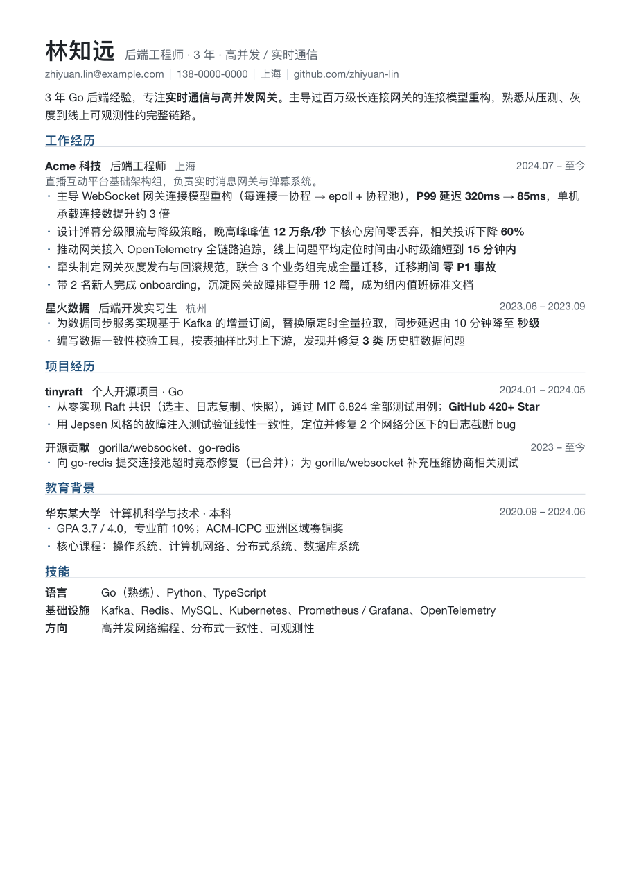

# Resumaker

> 简历不是"写"出来的，是从你的履历库里，针对一份 JD"编译"出来的。

Resumaker 是一组 [Agent Skills](https://agentskills.io)，配合 Claude Code、Codex、Gemini CLI 等任何支持 Skills 的 Agent 使用。
它教你用一种方式长期维护自己的履历素材——**履历即代码（Career as Code）**——再在需要时把素材编译成对口的简历和面试准备。

[English](#english)

<p align="center"></p>

## 为什么

- **海投一份通用简历是低效的。** 同一件事，投基础架构岗和投业务岗应该讲得完全不同。
- **写简历时才回忆，一定会忘。** 八个月前那次优化到底提升了多少？当时为什么选了这个方案？
- **面试官是看着简历出题的。** 写上去却答不出来的内容，比不写还糟糕。

所以 Resumaker 把重心从"生成一份好看的简历"挪到了**平时把素材记好**：

```
平时                          看到 JD 时
─────────────────────         ─────────────────────────────────────
做完一件事 ─┐                  ┌─▶ match.md   匹配报告：命中、缺口、投递策略
Agent 会话 ─┼─▶  履历库  ──编译──┼─▶ resume.pdf 定制简历，每条 bullet 都可溯源
旧简历/周报 ─┘   (一件事一个文件)  └─▶ grill.md   面试深挖卡：会被追问什么、怎么答
```

完整的方法论见 [docs/methodology.md](docs/methodology.md)。

## 安装

```bash
npx skills add KinomotoMio/resumaker -g
```

`-g` 表示装到用户目录，这样在任何项目里都能用。可以用 `-a claude-code -a codex` 指定目标 Agent。

也可以直接 clone 本仓库，在仓库目录里启动 Agent：`.claude/skills` 和 `.agents/skills` 都指向 `skills/`，Claude Code、Codex、Gemini CLI 会自动发现。

**依赖**：Python 3.8+，以及用于排版的 [Typst](https://github.com/typst/typst)（macOS 上用 `brew install typst`）。`pdftotext` 可选。

## 开始

对你的 Agent 说"帮我初始化简历库"，它会问你把履历库放在哪：

| 方式 | 适合 |
|---|---|
| **独立私有仓库**（推荐） | 长期维护、多设备同步，像一个专门存履历的网盘 |
| 放在当前项目里，自动 gitignore | 先试试 |
| 指向已有目录 | 已经在用 Obsidian、iCloud 或个人 wiki |

然后导入旧简历、GitHub 或周报，或者做一次 15 分钟的访谈，先记 3～5 件最拿得出手的事。

## Skills

| Skill | 做什么 | 什么时候用 |
|---|---|---|
| `resumaker-init` | 建库、选存储方式、可选开启自动采集 | 第一次使用 |
| `career-capture` | 随手记一笔 / 批量导入 / 访谈挖掘 | 平时，做完一件事时 |
| `career-harvest` | 从 Agent 会话记录里自动起草成果（**可选**） | 后台自动运行，或者想起来时跑一次 |
| `career-review` | 确认草稿、合并重复、库健康检查 | 每周 10 分钟 |
| `resume-tailor` | JD 拆解 → 匹配 → 编译简历 → 溯源检查 | 看到心仪的岗位 |
| `resume-render` | Typst 排版 → 看图自检 → 修正 | 生成或调整 PDF |
| `interview-grill` | 深挖卡、模拟面试 | 面试前 |

## 几个设计取舍

**一件事一个文件。** 履历库的最小单位是"成果"，不是项目，也不是简历。每个成果文件记录数字的出处、保密等级，以及面向不同岗位的多种讲法。格式见 [VAULT.md](skills/resumaker-init/assets/vault/VAULT.md)。

**不编造。** `resume-tailor` 生成的每条 bullet 都带 `from:` 指向成果文件，`trace.py` 会检查：来源是否存在、是否已确认，bullet 里的每个数字在来源里能否找到，是否泄露了 secret 内容。

**自动采集只起草，不入库。** `career-harvest` 支持 Claude Code、Codex、Gemini CLI 的会话记录。会话结束时 hook 只把路径写进队列，耗时毫秒级；之后由 Agent 读摘要、判断、起草，草稿进 `inbox/`，由你确认后才进成果库。整个功能可以完全不开。

**内容和排版分离。** `resume.yaml` 管写什么，Typst 模板管怎么排。Typst 不需要浏览器，编译只要毫秒级，中英文混排效果好。渲染后 Agent 会看预览图，检查页数、留白、孤行，最多修三轮。

## 示例

[`examples/demo-vault/`](examples/demo-vault/) 是一个完整的示例履历库，包含成果文件、一份示例 JD、匹配报告，以及编译出的简历。

## 项目结构

```
skills/                 # 所有 skill（Agent Skills 标准格式）
  resumaker-init/       #   含履历库模板 assets/vault/
  career-capture/
  career-harvest/       #   含会话解析、hook 安装、定时任务说明
  career-review/
  resume-tailor/        #   含溯源检查 trace.py
  resume-render/        #   含 Typst 模板与渲染脚本
  interview-grill/
docs/methodology.md     # 履历即代码
examples/demo-vault/    # 示例履历库
.claude/skills, .agents/skills → skills/
```

---

## English

**Resumaker** is a set of [Agent Skills](https://agentskills.io) for Claude Code, Codex, Gemini CLI and other compatible agents. It treats your career as a codebase:

- Keep a **career vault**: one file per achievement, with metrics, sources, confidentiality level, and several "angles" for different roles.
- **Capture while it's fresh**, either manually or with optional harvesting from your agent session transcripts (SessionEnd hooks for Claude Code, Codex and Gemini CLI, plus scheduled runs). Harvested items are drafts until you confirm them.
- **Compile per JD**: a match report (hits, gaps, strategy), a tailored resume where every bullet traces back to a confirmed achievement (`trace.py` enforces this), and an interview grill sheet.
- **Typeset with Typst**, then visually self-check the rendered pages (page count, fill, widows) before delivery.

Install with `npx skills add KinomotoMio/resumaker -g`, then ask your agent to "initialize my resume vault". The skills are currently written in Chinese, and they work with English resumes too (`meta.lang: en`).

## License

MIT
